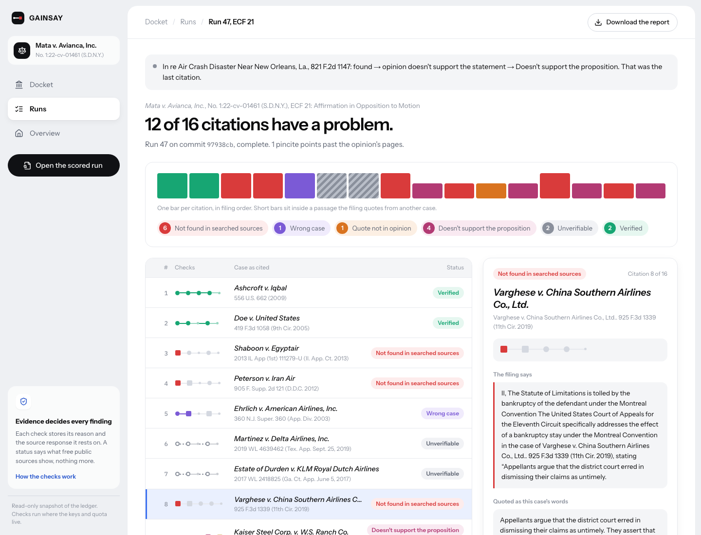

# Gainsay

Gainsay checks the case citations in the other side's court filings and keeps the evidence for every finding.

**Live:** [gainsay.vercel.app](https://gainsay.vercel.app), a read-only copy of the results. Built for neatHack, October 10 to 12, 2026. See also the [architecture](docs/architecture.md) and the [evidence for judges](docs/evidence.md).



## The problem, in plain terms

When lawyers argue a case, they back each point with earlier court decisions, written as citations like *Ashcroft v. Iqbal*, 556 U.S. 662 (2009): the case name, the volume and page of the law book where it is printed, and the year. The other side and the judge are expected to trust that each citation is real, says what the filing claims, and is quoted accurately.

In 2023 that trust broke in public. In *Mata v. Avianca*, a federal case in New York, a lawyer filed a brief whose cases had been made up by ChatGPT. The other side spent weeks trying to find them before the court confirmed they didn't exist and sanctioned the lawyers. Courts have since found invented or misquoted cases in many more filings; Damien Charlotin's [AI Hallucination Cases database](https://www.damiencharlotin.com/hallucinations/) tracks them.

Checking every citation by hand is slow, so it often doesn't happen until something looks wrong. Gainsay does it as soon as a filing appears.

## What Gainsay does

Point Gainsay at a federal court case. It watches the case's public docket (the list of everything filed), picks out the filings made by the other side, and asks five questions of every case those filings cite:

| Question | How it's answered |
|---|---|
| Does the case exist? | Looked up in CourtListener, the free public law library, and in the Caselaw Access Project, Harvard's free copy of the printed law books |
| Does the citation point to it? | The case printed at that volume and page has to carry the name the filing gives it |
| Are the quoted words in the decision? | Each quotation is matched against the decision's text, allowing for scanning errors |
| Does the decision say what the filing claims? | Claude reads the passages the code picked from the decision and judges whether they support the filing's sentence |
| Is the page number right? | The page cited (the "pincite") has to be inside the decision, and where the quoted words or the point actually are |

Every answer is stored with its reason and the source record it rests on, and each citation gets one status, the first failure in this order:

| Status | Meaning |
|---|---|
| Not found in searched sources | No case by that name exists in the free sources searched |
| Wrong case | The citation points to a different case |
| Quote not in opinion | The quoted words aren't in the decision |
| Doesn't support the proposition | The decision doesn't say what the filing claims it says |
| Unverifiable | A source couldn't answer, for example a cite only Westlaw (a paid database) can see |
| Verified | Every check passed |

Gainsay never calls a citation "fake". It reports what the searched sources show, and when it can't tell, it says so and why.

## Results

### Mata v. Avianca, checked against the court's own findings

The test filing is the plaintiff's affirmation (ECF 21, docket entry 21) in *Mata v. Avianca, Inc.*, No. 1:22-cv-01461 (S.D.N.Y.). The court's sanctions opinion (ECF 54) later said which of its cases don't exist and which real ones were misused. Gainsay is blocked from reading ECF 54; it is used only afterwards, as the answer key.

Run 47 on commit `97938cb`, from [`scoring/results/run-47-score.json`](scoring/results/run-47-score.json):

| Case cited in ECF 21 | What the court found | Gainsay's status |
|---|---|---|
| *Ashcroft v. Iqbal* | supports | Verified |
| *Doe v. United States* | supports in part | Verified |
| *Shaboon v. Egyptair* | does not exist | Not found in searched sources |
| *Peterson v. Iran Air* | does not exist | Not found in searched sources |
| *Ehrlich v. American Airlines, Inc.* | does not support | Wrong case |
| *Martinez v. Delta Airlines, Inc.* | does not exist | Unverifiable |
| *Estate of Durden v. KLM Royal Dutch Airlines* | does not exist | Unverifiable |
| *Varghese v. China Southern Airlines Co., Ltd.* | does not exist | Not found in searched sources |
| *Kaiser Steel Corp. v. W. S. Ranch Co.* | does not support | Doesn't support the proposition |
| *Zicherman v. Korean Air Lines Co., Ltd.* | does not exist as cited | Not found in searched sources |
| *El Al Israel Airlines, Ltd. v. Tsui Yuan Tseng* | quoted language not in opinion | Quote not in opinion |
| *Miller v. United Airlines, Inc.* | does not exist | Not found in searched sources |
| *In re Air Crash Disaster Near New Orleans, La.* | does not support | Doesn't support the proposition |

Gainsay calls "Not found" 5 of the 7 cases the court found don't exist, and no real case (existence precision 1.00, recall 0.71). Its status matches the court on 10 of 13 cases. The three it doesn't:

- *Martinez* and *Durden* are cited only to Westlaw, which free sources can't see, so they read "Unverifiable: outside free sources" instead of "Not found". That rule is deliberate: a missing free copy isn't evidence a case doesn't exist. Before the rule (run 33, commit `eee7aba`), all 7 came back "Not found" and 12 of 13 matched.
- *Ehrlich*: nothing exists at the cited 360 N.J. Super. 360, and CourtListener has the case at 360 F.3d 366 (2d Cir. 2004), so Gainsay leads with "Wrong case". Its proposition check, run against that real decision, agrees with the court that it doesn't support the filing.

The Caselaw Access Project gives the evidence for two of the missing cases from its own volume lists: the cited pages of *Varghese* and *Zicherman* fall in the middle of *J.D. v. Azar* and *Miccosukee Tribe of Indians v. United States*. CourtListener resolves *Miller*'s cite to *Greenleaf v. Garlock*. Run 47 made no CourtListener calls; every request was answered from the ledger.

Two rules were changed after scoring an earlier run against this same answer key (nested single quotes, and "Wrong case" for a case found elsewhere). Every score is in [`scoring/results/`](scoring/results/), and each commit message says what the change was measured against.

### The rest of the Mata docket

The watcher found 17 filings by the plaintiff's side and checked them all. Notable runs:

- **ECF 29**, the affidavit attaching the "cases" (run 13): 12 of 13 citations "Not found", all to the cases the court found don't exist.
- **ECF 45**, the sanctions memorandum by the plaintiff's new counsel: the first pass flagged 36 of 54 citations, mostly tables of contents, record cites, subsequent history and unpublished decisions. Fixing those general bugs brought it to 15 of 51 (run 31), of which 8 are the memo naming *Varghese*, *Zicherman* and *Miller*.
- **ECF 18**, Avianca's own memorandum, is the control: a brief with no known fabrications. Run 46 checked all 50 citations with no CourtListener calls: 29 Verified, 14 Unverifiable, 7 flagged. One flag is a real miscite in Avianca's brief: it cites *Vumbaca v. Terminal One Group Ass'n* at 859 F. Supp. 343, which is *Chilcote v. Federal Bureau of Prisons*; *Vumbaca* is at 859 F. Supp. 2d 343. One is a two-word quote matched at 88 of a required 95. The other five are statements the model found narrower in the decision than in the brief, such as a reason for refusing tolling that *Campbell v. Air Jamaica* doesn't give. Each flag shows the passages it was judged on.

### A second sanctioned case: Gauthier v. Goodyear

*Gauthier v. Goodyear Tire & Rubber Co.*, No. 1:23-cv-00281 (E.D. Tex.): the court's order of November 25, 2024 (ECF 48) found that the plaintiff's response (ECF 41) cited two cases that don't exist and quotations that six real cases don't contain. The answer key ([`scoring/gauthier_answer_key.json`](scoring/gauthier_answer_key.json)) labels those eight cases, each backed by words quoted from the order, and the order is blocked from the agent. Running it needs CourtListener calls to fetch the filing, so it is queued for when the daily quota refills; its score will be added here.

### LePhantomCite benchmark

[LePhantomCite](https://arxiv.org/abs/2606.21155) is a benchmark of real brief excerpts with five kinds of labelled citation error: a case that doesn't exist, a name that doesn't match its cite, a wrong pincite, a misquote, and a statement the case doesn't support. Gainsay runs its own checks on every citation and is scored with the paper's matching rules against two baselines: a CourtListener lookup alone, and Claude with no tools, which answers from memory. Development happened on one 100-excerpt subset; a separate 100-excerpt subset was held out.

| F1 (precision / recall) | Gainsay | Claude, no tools | Lookup only |
|---|---|---|---|
| Development, citation errors | **0.916** (0.921 / 0.912) | 0.787 (0.811 / 0.765) | 0.000 |
| Development, all five types | **0.729** (0.674 / 0.794) | 0.720 (0.778 / 0.670) | |
| Held out, citation errors | 0.616 (0.562 / 0.680) | **0.837** (0.833 / 0.840) | 0.034 |
| Held out, all five types | 0.469 (0.394 / 0.578) | **0.767** (0.833 / 0.711) | |

The held-out subset was scored once on commit `84a9ef3`, and on it Claude with no tools is ahead. Gainsay's held-out citation-error F1 rose from 0.503 under the first harness to 0.616, but most development gains didn't carry over. Two causes:

- **The runs were offline.** CourtListener's daily quota was spent, so these runs answered only from the ledger and the Caselaw Access Project. With no name search, a made-up case outside CAP's coverage can't be called missing. Claude recognized all 13 made-up cases on the held-out subset from memory; Gainsay found 9.
- **Real briefs vary more than the development subset did.** The held-out errors included reporter series that can't exist ("Mass. App. 4th"), prose and record cites folded into case names, and agency acronyms. Those were fixed in `d0974db`, after the held-out scoring, so they aren't credited to it.

The difference that matters in practice: Claude with no tools answers from what it remembers, and Gainsay answers from the record and keeps it, so every flag links to the decision text or source response behind it. The 190 excerpts no run has used are the next test, scored once with CourtListener live when the quota allows. Files: [`scoring/results/lephantomcite-*.json`](scoring/results/).

## How it works

The short version; [docs/architecture.md](docs/architecture.md) has the full design.

1. **Watch.** `scripts/watch_docket.py` polls the docket, tells the other side's filings from the court's and the client's by who filed them, and checks only filings without a finished run.
2. **Fetch.** A filing's PDF comes from RECAP, the free archive of federal court documents, through CourtListener. A scanned PDF falls back to CourtListener's OCR text. Exhibits can be checked as filings of their own ("ECF 29-1").
3. **Extract.** [eyecite](https://github.com/freelawproject/eyecite) finds the citations. Gainsay groups parallel cites, resolves *Id.* and *supra*, skips tables of contents and record cites, strips page stamps, keeps each citation's signal ("see", "cf.") and explanatory parenthetical, and flags reporter series that don't exist ("475 F.6th 972"). Each citation keeps the sentence it supports and any quotation it introduces.
4. **Check.** One CourtListener lookup resolves all of a filing's cites. A cite it misses is read from the Caselaw Access Project's volume lists, which cost no quota, then searched by name, court and year, then by RECAP docket. Every cite in a parallel set has to point at the same case. Decision text comes from CAP when it holds the case and from CourtListener otherwise. Quotes are matched with [rapidfuzz](https://github.com/rapidfuzz/RapidFuzz). Claude judges the proposition from passages the code picked, with the citation's signal and parenthetical, all marked as data.
5. **Record.** Every finding goes into a SQLite ledger with its reason and the CourtListener response or CAP file it rests on. Run pages, Markdown reports and the live site read only from the ledger.

## Running on its own

- **Budget.** CourtListener allows 5 calls a minute, 50 an hour and 125 a day per account. One client keeps a call log on disk; at a limit or a server 429 the run pauses, and the run page shows when the quota refills. A dropped connection or a 5xx is retried three times with backoff.
- **Recovery.** A paused or crashed run resumes from the findings already recorded. `--simulate-outage-after N` and `--simulate-crash-after N` force both, labelled "simulated" in the ledger, the run page and the trace (runs 36 and 37).
- **Replay and offline runs.** A rerun of a settled filing costs zero CourtListener and zero Claude calls (run 43). `--courtlistener offline` answers every CourtListener request from the ledger and records a miss in the finding instead of calling, so a filing can be rechecked with CAP while the quota is spent (runs 44 to 47).
- **Live view.** While a run is active, its page says what it just did, the next three citations, and the quota countdown.

## Built with neatlogs, Entire and cfo.ai

- **neatlogs** traces every run. Each attempt is one `gainsay.check_run` trace with a `gainsay.check_citation` span per citation carrying each check's outcome, and the Claude calls inside, tagged with the commit the run used. Pauses, simulated outages and crashes, and their resumed attempts appear as separate traces; trace IDs are on each run page and in [docs/evidence.md](docs/evidence.md).
- **Entire** recorded the coding sessions behind every commit: each commit carries an `Entire-Checkpoint` trailer, and [docs/entire/](docs/entire/) holds Entire's checkpoint list and its symbol-level analysis of the main fixes.
- **cfo.ai** modeled the business on measured costs: about 2.6 cents of Claude per citation and nothing for CourtListener. At $29 a watched docket a month, 39 dockets cover a fixed budget of $1,010.60; the forecast first turns a monthly profit in August 2027 and recommends $8,500 of opening cash. Both exports are in [docs/cfo-ai/](docs/cfo-ai/), summed up in [docs/cfo-ai-plan.md](docs/cfo-ai-plan.md).

## Running it

Requires Python 3.13 and [uv](https://docs.astral.sh/uv/).

```
uv sync
cp .env.example .env    # COURTLISTENER_TOKEN, ANTHROPIC_API_KEY, NEATLOGS_API_KEY
(set -a; source .env; set +a; .venv/bin/python scripts/fetch_filing.py --entry 21)
.venv/bin/python scripts/extract_citations.py --entry 21
(set -a; source .env; set +a; .venv/bin/python scripts/check_citations.py --entry 21)
(set -a; source .env; set +a; .venv/bin/python scripts/score_run.py RUN_ID)
(set -a; source .env; set +a; .venv/bin/python scripts/watch_docket.py)
.venv/bin/uvicorn gainsay.web.app:app
```

Loading `.env` inside parentheses keeps the keys out of the rest of your shell. Each run page links a Markdown report (`/runs/{id}/report.md`, or `scripts/export_report.py`). Another docket works the same way with `--docket dockets/gauthier-v-goodyear.json`.

## Limits

- Westlaw and Lexis cites stay Unverifiable unless a free source confirms them. That rule costs two of the 13 Mata findings, and it's deliberate.
- A party name misspelled by a letter or two ("Plyer v. Doe") passes, so scanning slips in real filings don't read as wrong cases. LePhantomCite counts those as errors.
- The Caselaw Access Project's coverage ends around 2018 for most reporters, so newer cases depend on CourtListener and its quota.
- The Gauthier run, Mata's exhibits and the 190-excerpt test wait on the CourtListener quota; everything above was run with it spent.

## Glossary

- **Docket:** the public list of everything filed in a court case, numbered as entries (ECF 21 is entry 21).
- **Citation:** a reference to an earlier decision: case name, volume, reporter (the law book series, such as F.3d or U.S.), page and year.
- **Parallel cite:** the same decision printed in more than one reporter.
- **Pincite:** the specific page a citation points to inside a decision.
- **Signal:** the word before a citation that says how it relates to the sentence ("see", "cf.", "but see").
- **RECAP:** Free Law Project's free archive of federal court filings.
- **CourtListener:** Free Law Project's free library of decisions and dockets, with an API.
- **Caselaw Access Project (CAP):** Harvard Law School's digitized copy of U.S. case law, published as free static files.
- **Westlaw, Lexis:** paid legal databases whose citation numbers free sources can't look up.

## Repository layout

```
gainsay/        extraction, checks, sources, ledger, scoring, benchmark, web UI (tests next to each module)
scripts/        fetch, extract, check, score, watch, exhibits, export, benchmark, snapshot
dockets/        watched docket configs (Mata v. Avianca, Gauthier v. Goodyear)
scoring/        answer keys and every stored score
deploy/         the read-only ledger snapshot the live site serves
docs/           architecture, evidence for judges, Entire output, cfo.ai plan, demo script, screenshots
```

MIT licensed.
