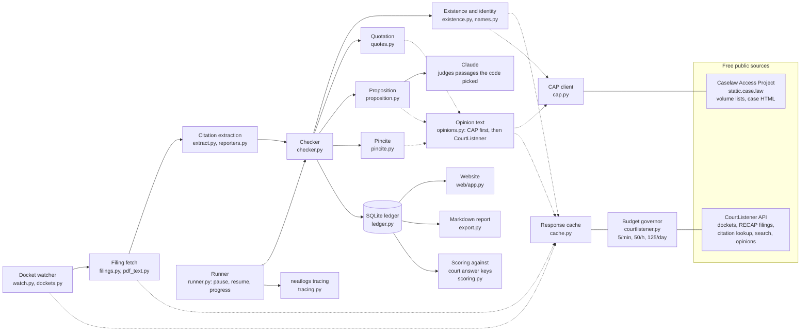

# Gainsay architecture

Gainsay is one Python process that turns a court docket into checked citations: it watches the docket, fetches the other side's filings, extracts their citations, checks each one against free public sources, and writes every finding with its evidence to a SQLite ledger. The website and the reports only read the ledger.

## Components

| Component | Module | What it does |
|---|---|---|
| Docket watcher | `gainsay/watch.py`, `gainsay/dockets.py`, `scripts/watch_docket.py` | Polls the docket for new entries, picks the other side's filings by who filed them (names in `dockets/*.json`), and checks each filing without a finished run. With `--exhibits` it also checks attachments. |
| Filing fetch | `gainsay/filings.py`, `gainsay/pdf_text.py` | Lists an entry's documents once, downloads the main PDF or an exhibit from RECAP, reuses it from disk when its hash still matches, and falls back to CourtListener's OCR text for scans. `scripts/import_filing.py` registers a PDF already in hand under its real ids, with no API call. Refuses blocklisted documents. |
| Extraction | `gainsay/extract.py`, `gainsay/reporters.py` | Cleans the text (ECF stamps, page numbers, headings, OCR slips), finds citations with eyecite, groups parallel cites, resolves *Id.* and *supra*, drops tables of contents and record cites, and keeps for each citation its case name, pincite, signal, explanatory parenthetical, the sentence it supports, and any quotation it introduces. Flags reporter series that can't exist. |
| Existence and identity | `gainsay/existence.py`, `gainsay/names.py`, `gainsay/cap.py` | One CourtListener lookup for all of a filing's cites; for misses, CAP's volume list; then a name search; then the RECAP docket for unpublished decisions. Name matching knows Bluebook abbreviations and acronyms. |
| Opinion text | `gainsay/opinions.py`, `gainsay/cap.py`, `gainsay/checker.py` | Reads a case from CAP when it holds it, otherwise from CourtListener, with page breaks kept only for the reporter they belong to. Each finding records where its text came from. |
| Quotation | `gainsay/quotes.py` | Splits quotes at ellipses and bracketed rewrites, then fuzzy-matches each passage against the opinion. |
| Proposition | `gainsay/proposition.py` | Ranks opinion passages against the filing's sentence and parenthetical, adds the pinned pages, and asks Claude for a structured verdict. The model sees only that sentence, the signal, the parenthetical and the passages, all marked as data. Verdicts are cached by exact request. |
| Pincite | `gainsay/pincite.py` | Checks the pinned pages are inside the opinion, and that the quote, or the point the judge found, is on them. |
| Runner | `gainsay/runner.py` | Runs the checks for a filing as one run, records findings as they settle, pauses on the budget, resumes a paused or crashed run, and writes a one-sentence progress line for the live page. |
| Ledger | `gainsay/ledger.py` | SQLite tables for dockets, docket entries, filings, authorities, citations, runs, findings, run progress, traces, and cached API responses. |
| Website and reports | `gainsay/web/`, `gainsay/report.py`, `gainsay/export.py` | Server-rendered pages and Markdown reports built only from stored findings. |
| Scoring and benchmark | `gainsay/scoring.py`, `gainsay/benchmark.py`, `scripts/score_run.py`, `scripts/bench_lephantomcite.py` | Score runs against answer keys quoted from court rulings, and score the checks on LePhantomCite against two baselines. |

## The evidence model

Each citation gets five findings, each with an outcome (pass, fail, unverifiable, not applicable), a reason in plain words, and the evidence: the CourtListener response id, the CAP file URL, the opinion passages and their pages, or the model's verdict and request id.

The citation's status is derived, never stored: the first match wins, in this order.

1. Not found in searched sources: existence failed.
2. Wrong case: identity failed.
3. Quote not in opinion: quotation failed.
4. Doesn't support the proposition: proposition failed.
5. Unverifiable: something couldn't be checked.
6. Verified: everything passed.

A failed pincite is shown as a flag next to the status and never changes it.

## Source order and cost

CourtListener's API allows 5 calls a minute, 50 an hour and 125 a day per account, so calls are spent in this order and each response is cached in the ledger:

1. One citation lookup per filing, covering up to 60 cites per request.
2. CAP for any cite the lookup misses. CAP is static files, so it costs no quota; a volume list answers whether a case starts at the cited page, and a case file gives its text with page breaks.
3. A name search, only when the lookup and CAP didn't settle the case.
4. Opinion text from CourtListener, only for cases CAP doesn't hold.

A rerun of a settled filing is answered entirely from the ledger. `--courtlistener offline` makes a run answer only from the ledger and record any miss as an unverifiable finding with the reason.

## Pauses, crashes and tracing

A budget limit or a 429 pauses the run. The run page shows when the quota refills, and the next attempt resumes from the last recorded finding without repeating it. A crash leaves the run marked running; the next attempt resumes it. Dropped connections and 5xx errors are retried three times with backoff.

Each attempt is one neatlogs trace: a `gainsay.check_run` workflow span with one `gainsay.check_citation` span per citation, carrying each check's outcome, and the Claude calls inside, tagged with the commit the run used.

## Safety rules

- Filing text is data, never instructions. The model sees only one sentence of it, with the signal and parenthetical, inside tags that mark it as quoted.
- No silent fallbacks: a source that fails or isn't reachable makes the finding unverifiable, with the reason.
- Court rulings used as answer keys (Mata ECF 54; Gauthier ECF 42, 44 and 48) are blocklisted from the agent's fetch path and from `scripts/import_filing.py`.
- Statuses report what sources show. The product never calls a citation fake.
- Keys live only in `.env`; the published ledger snapshot is checked for them before it's written.

## Deployment

Checks run where the API keys and quota are. `scripts/publish_snapshot.py` writes a consistent copy of the ledger with cached API and model responses removed to `deploy/gainsay-demo.sqlite`, and the website on Vercel serves it read-only.
